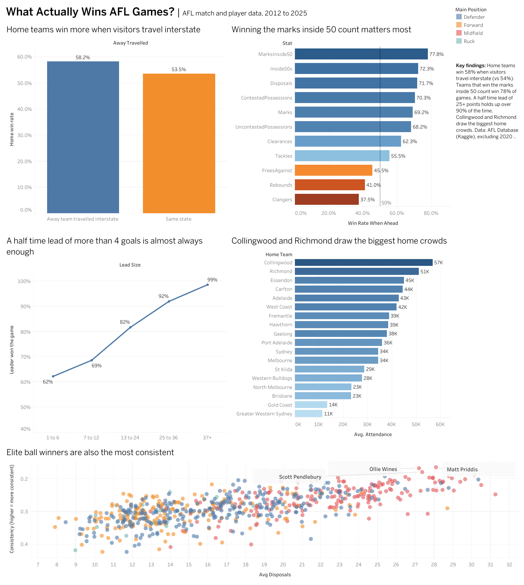

# What Actually Wins AFL Games?

**Tools:** Python (pandas, NumPy, matplotlib) · Jupyter · Tableau Public
**Skills:** Data cleaning · Data validation · Feature engineering · Exploratory analysis · Data visualisation · Dashboard design

### [View the interactive Tableau dashboard](https://public.tableau.com/app/profile/varshini.anand4745/viz/WhatActuallyWinsAFLGames/AFLDashboard)



---

## Business Problem

Acting as a data analyst for an AFL club, I used 14 seasons of match and player data to answer questions from the coaching and commercial teams:

1. Is home ground advantage real, and is it bigger when the visitors travel interstate?
2. Which team stats separate winners from losers?
3. Does rain change how the game is played?
4. How safe is a half time lead?
5. What drives crowd sizes?
6. Which players are the most consistent ball winners?

## Dataset

[Australian Football League (AFL) Database](https://www.kaggle.com/datasets/stoney71/aflstats) on Kaggle, sourced from afltables.com and footywire.com. Seasons 2012 to 2025.

| File | Rows | Description |
|---|---|---|
| games.csv | 2,879 | One row per match: teams, venue, scores by quarter, crowd, weather |
| stats.csv | 128,938 | One row per player per match: disposals, marks, tackles and more |
| players.csv | 1,825 | One row per player: position, height, weight |

The raw data isn't included in this repo. Download it from Kaggle and place the three CSV files in a `data` folder to run the notebook.

## Data Cleaning

The data looked clean at first, but validation checks found several real problems:

* **651 corrupted scores.** In the source file, scores lost their trailing zero, so `14.10` (14 goals, 10 behinds) was saved as `14.1`. I rebuilt the full time behinds from the final score, and fixed half time scores using the rule that behinds can never go down during a game. After the fix, every score matched the official result.
* **Reused match IDs.** 3 GameIds were shared by 6 different 2024 Opening Round matches. I gave each match a unique ID.
* **138 duplicate rows** in the player stats, which I removed.
* **Mismatched IDs between files.** In 2024, the GameIds in the player stats don't line up with the games table. To avoid linking stats to the wrong match, I only kept a link when both teams agreed in both files, and left 2024 out of the player stat analysis.
* **Rushed behinds.** Player stats total about 2 points less than the official score per game, because rushed behinds aren't credited to any player, so I used official scores for every result.
* **Zero crowds in 2020** were games played without fans, so I treated them as missing rather than as real crowd counts.

## Key Findings

1. **Home advantage is real, and travel makes it bigger.** Home teams won 56.6% of games overall. When the visitors had travelled interstate, the home team won 58.2% with an average margin of 8 points, compared with 53.5% and 2 points when both teams were from the same state.
2. **Marks inside 50 matter most.** Teams that won the marks inside 50 count won 77.8% of games, followed by inside 50s (72.3%). More rebounds (41%) and clangers (37.5%) went with losing.
3. **Rain makes the game tighter.** Wet games averaged 160 points compared with 168 in dry games, with a higher share of contested possessions, more tackles and fewer marks.
4. **A half time lead of more than 4 goals is almost always enough.** Leads of 1 to 6 points held up 62% of the time, rising to 92% for 25 to 36 points and 98.6% for 37 or more.
5. **Big clubs and night games draw the crowds.** The MCG averaged over 55,000. Night games drew about 40,000 compared with 31,000 for day games, and Collingwood and Richmond had the biggest home crowds.
6. **Elite ball winners are also the most consistent.** Among players averaging 25+ disposals, midfielders such as Matt Priddis, Ollie Wines and Scott Pendlebury had the most consistent output from game to game.

## What This Means for a Club

* **Coaching:** focus on getting the ball inside 50 and creating marking chances there, since these stats separate winners from losers more than tackles or clearances.
* **Travel:** interstate trips cost visiting teams roughly 6 points on average, so recovery and travel planning for away trips can make a real difference.
* **Commercial:** night fixtures and big drawing opponents bring the largest crowds, which matters for scheduling requests and ticket pricing.

## Repository Structure

```
├── README.md
├── afl_analysis.ipynb        # cleaning, analysis and charts
├── tableau/                  # cleaned files exported for Tableau
│   ├── games_clean.csv
│   ├── team_games.csv
│   ├── stats_that_win.csv
│   └── player_consistency.csv
└── images/
    └── afl_dashboard.png
```

## How to Run

1. Download the dataset from Kaggle and place `games.csv`, `stats.csv` and `players.csv` in a folder called `data` next to the notebook.
2. Install the libraries: `pip install pandas numpy matplotlib`
3. Open `afl_analysis.ipynb` in Jupyter or VS Code and run all cells. The cleaned files for Tableau are saved in the `tableau` folder.
